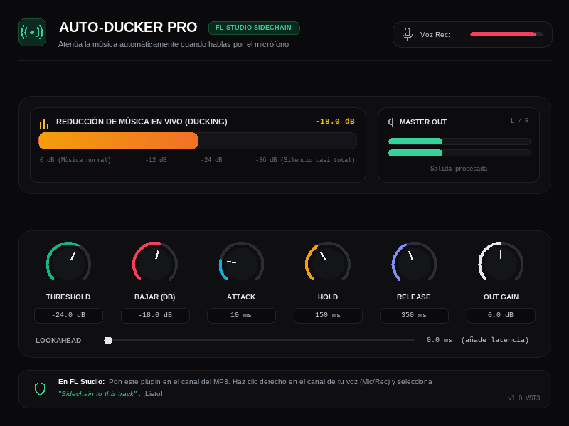

# Auto-Ducker Pro
 
Plugin VST3 con **sidechain** para FL Studio. Baja automáticamente el volumen de la música cuando
hablas por el micrófono y lo vuelve a subir suavemente cuando dejas de hablar.
 

 
## Cómo funciona
 
El plugin se pone en el canal de la **música**. Escucha una segunda señal, tu **voz** (el sidechain),
y cuando esa señal pasa del umbral, baja la música los decibelios que indiques. Al callar, la
música vuelve a su nivel con un tiempo de espera y de subida ajustables.
 
## Cómo configurarlo en FL Studio
 
1. **Inserta el plugin** en el canal del Mixer donde está tu música / pista MP3.
   No lo pongas en el canal de la voz ni en el Master.
2. **Crea el sidechain.** Selecciona el canal de tu micrófono o grabación (**Rec**), haz clic
   derecho en la flecha de envío del canal de la música y elige **Sidechain to this track**.
3. **Asigna la entrada en el plugin.** Ábrelo, pulsa el engranaje, entra en *VST Wrapper Settings*
   y ve a la pestaña **Processing**. Pulsa **Reset** y luego **Auto map inputs**; en
   **2. Sidechain** debe aparecer el canal de tu voz.
4. **Ajusta los mandos:**
   * **Threshold:** sensibilidad con la que detecta tu voz.
   * **Bajar (dB):** cuántos decibelios baja la música cuando hablas (por ejemplo, `-18 dB`).
   * **Hold y Release:** el tiempo que la música espera y lo que tarda en subir suavemente cuando
     dejas de hablar.
5. **Prueba.** Dale a play y habla: el medidor **Voz Rec** se mueve y la barra de reducción se
   llena. Si no se mueve, la voz no está llegando al plugin.
## Parámetros
 
| Mando | Rango | Por defecto | Qué hace |
|---|---|---|---|
| Threshold | −60 … 0 dB | −24 | Nivel de la voz a partir del cual actúa |
| Bajar (dB) | −40 … 0 dB | −18 | Cuánto baja la música |
| Attack | 1 … 200 ms | 10 | Rapidez al bajar |
| Hold | 0 … 1000 ms | 150 | Tiempo que mantiene la bajada tras callar |
| Release | 10 … 2000 ms | 350 | Rapidez al volver a subir |
| Out Gain | ±12 dB | 0 | Ganancia de salida |
| Lookahead | 0 … 20 ms | 0 | Anticipación; añade latencia, que FL compensa |
 
**Uso de los mandos:** arrastra arriba o abajo (con Shift, más fino), usa la rueda del ratón, y
haz doble clic para volver al valor por defecto.
 
## Si algo no funciona
 
* **Las casillas de *Processing* salen vacías (`···`):** la lista solo ofrece canales que ya
  envían audio a ese canal. Crea el enlace del paso 2 y vuelve a cargar el plugin.
* **La música no baja:** comprueba que el audio de la música pasa por el canal donde está el
  plugin y que la voz entra por el canal que enlazaste.
* **Sin sidechain activado:** el plugin escucha su propia señal y baja la música cuando *ella
  misma* supera el Threshold, no cuando hablas.
* **FL Studio se bloquea:** el plugin escribe un registro en `%TEMP%\FlowHost_Auto_Ducker_Pro.log`.
  Su última línea indica hasta dónde llegó.
## Instalación
 
Copia la carpeta **entera** `Auto-Ducker_Pro.vst3` a
`C:\Program Files\Common Files\VST3\` y, en FL Studio, ve a
*Options → Manage plugins → Find installed plugins*.
 
> Plugin no oficial, sin relación con Google. El archivo no está firmado, por lo que Windows o el
> antivirus pueden mostrar un aviso.
 
